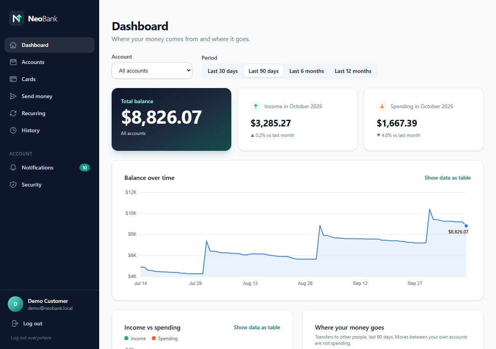
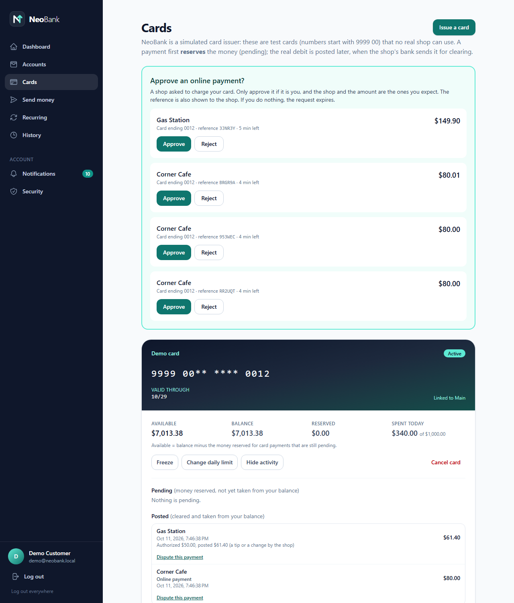
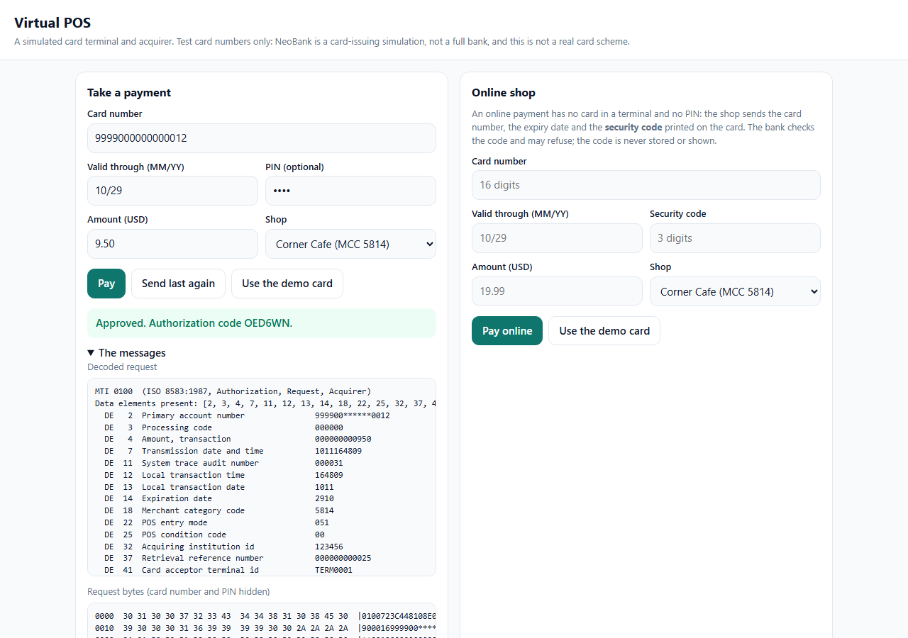
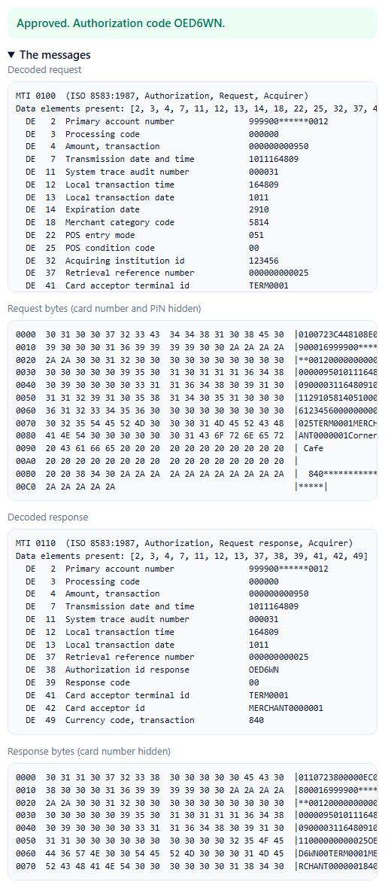
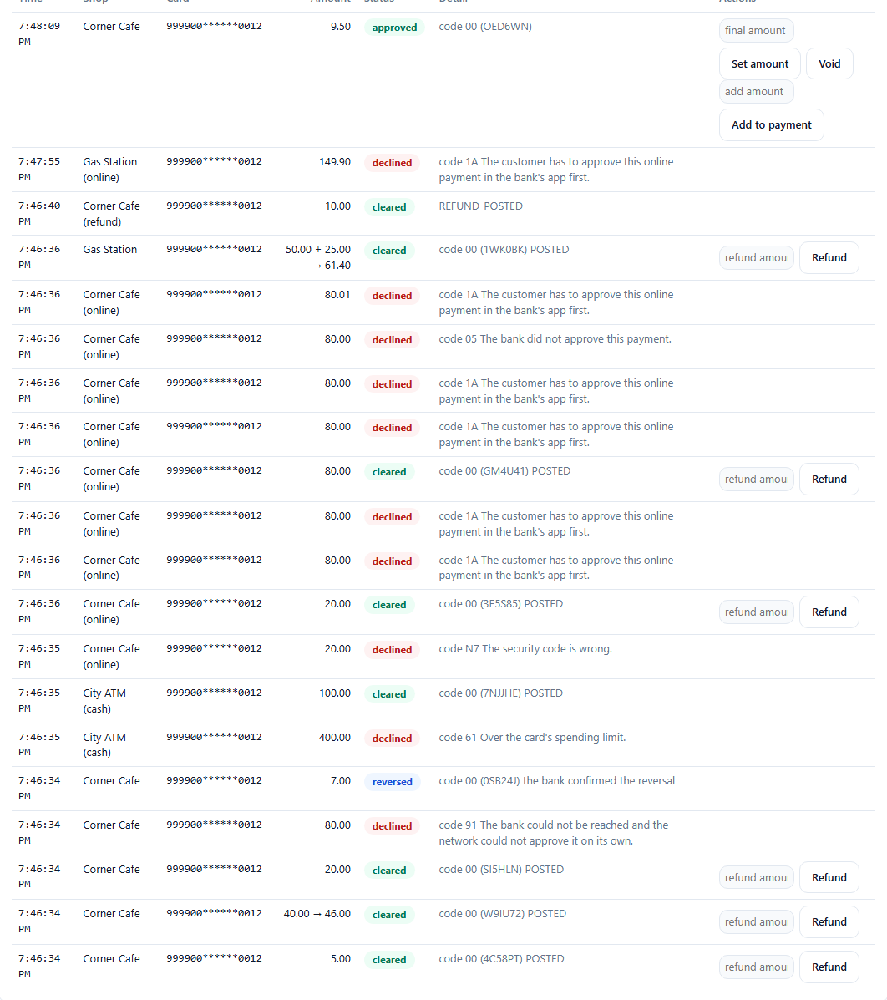

<h1 align="center">NeoBank</h1>

<p align="center">
  <strong>A card payment, end to end.</strong><br>
  From the shop's terminal to the bank's ledger, and on to the settlement between banks.
</p>

<p align="center">
  <a href="https://github.com/bilalkarakira/neobank-backend/actions/workflows/ci.yml"></a>
  
  
  
  
  
  
</p>

NeoBank is a **simulated card-issuing bank** and the whole world around a card payment: a **card network**, an **acquirer** with a
**virtual point-of-sale terminal**, and the **files the banks exchange** at the end of the day (clearing, settlement, disputes).
The parties speak real **ISO 8583 messages over TCP**, so you can watch what happens in the two seconds between a shop's terminal
and your bank, and in the hours that follow.

> **Honest scope.** NeoBank is a **learning and portfolio simulation**, not a bank. No licence, no KYC or AML, no real card
> scheme: the messages are ISO 8583:1987 plus common usage, *not* a Visa or Mastercard profile, and test card numbers start with
> `999900`. All keys are development defaults. Do not point this at anything real. See [docs/LIMITS.md](docs/LIMITS.md) for exactly
> what is simulated and what is simplified.

This repository is the **backend** and everything behind the web app: the issuer (Spring Boot), the card network and the
acquirer (`cardnet/`), and the demo stack (`demo/`). The web app is in the companion repository
[neobank-frontend](https://github.com/bilalkarakira/neobank-frontend).

**Contents:**
[What is NeoBank?](#what-is-neobank) ·
[The app at a glance](#the-app-at-a-glance) ·
[One payment, step by step](#one-payment-step-by-step) ·
[What it can do](#what-it-can-do) ·
[Architecture](#architecture) ·
[Tech stack](#tech-stack) ·
[Engineering highlights](#engineering-highlights) ·
[Quick start](#quick-start-with-docker-recommended) ·
[Run it locally](#run-it-locally-for-development) ·
[Testing and quality](#testing-and-quality) ·
[Documentation](#documentation) ·
[Limits and roadmap](#limits-and-roadmap)

## What is NeoBank?

Most people never see what happens when they pay by card. NeoBank makes it visible, in code you can run on your own machine.

A card payment is really **two stories**. The first happens in **real time**: within milliseconds the shop's bank asks your bank
*"may this go ahead?"*, your bank checks the card, the PIN, your limits and your balance, **reserves** the money, and answers yes or
no. The second happens at **the end of the day**: the shop's bank sends the final amounts (a tip may have changed them), your bank
**posts the real debit**, and the banks **settle** what they owe each other. NeoBank implements both, with the cases that make
payments hard in real life: the same message twice, no answer in time, a bank that is down, a customer who disputes a payment.

Three kinds of user meet in it:

| Who | What they use | Where |
|---|---|---|
| **A customer** | the bank's web app: accounts, transfers, history, a spending dashboard, and **cards** (issue, freeze, set a limit, see pending and posted payments, dispute one, approve an online payment) | http://127.0.0.1:4200 |
| **A shop** | a **virtual POS**: a web page that stands in for a card terminal and an online checkout, and shows every message it sends and receives, decoded | http://127.0.0.1:9000 |
| **The bank's staff** | admin pages: authorizations, **clearing**, **settlement and reconciliation**, disputes, an audit trail | the same web app, logged in as the admin |

## The app at a glance

**The customer's dashboard**: balances, income against spending, and a balance-over-time chart (every chart has a table view too).

<p align="center"></p>

**Cards**: the card, what is reserved against what is posted, and an online payment waiting for the customer's approval (a simulation of the idea of 3-D Secure).

<p align="center"></p>

**The shop's virtual POS**: take a payment and see the ISO 8583 request and response decoded field by field, plus the raw bytes with the card number and PIN hidden.

<p align="center"></p>

<p align="center"></p>

**The shop's payment list**: approved, cleared, declined, reversed and refunded payments, with the reason for every decline.

<p align="center"></p>

**The bank's settlement page**: what was authorized, what was cleared and what was settled, from the bank's own records, with every difference explained.

<p align="center"></p>

**On a phone**: the same Cards page at 390 px wide.

<p align="center"></p>

## One payment, step by step

| # | What happens | When | Where to see it |
|---|---|---|---|
| 1 | The shop's terminal builds an **ISO 8583 `0100`** message: card number, amount, merchant, PIN block | ms | the shop page, "The messages" |
| 2 | The **acquirer** (the shop's bank) sends it to the **card network**, which routes it by the card number to the right bank | ms | the network panel |
| 3 | The **issuer** (NeoBank) applies its rules in a fixed order: card status, expiry, PIN, limits, velocity, funds | ms | [ARCHITECTURE.md](docs/ARCHITECTURE.md) |
| 4 | It answers `00` (approved) or a decline code, and **reserves** the money: a *hold*, not yet a debit | ms | Cards, "Pending" |
| 5 | At the end of the day the shop **closes the day**: one encrypted **clearing file** carries the final amounts | hours later | the shop page, "Close the day" |
| 6 | NeoBank reads it, **posts the real debit** and releases the hold | seconds | Cards, "Posted" |
| 7 | The network **settles** the day between the banks: one net amount each, as CSV and camt.053-style statements; NeoBank recomputes the figures itself | end of day | admin, "Settlement" |
| 8 | A **reconciliation** checks that authorized, cleared and settled agree, and a customer can **dispute** a payment: credit now, chargeback through the network | after | admin, "Disputes" |

[docs/HOW-IT-WORKS.md](docs/HOW-IT-WORKS.md) walks through all of it with sequence diagrams.

## What it can do

| Area | What happens | Try it |
|---|---|---|
| **Authorization** | The issuer applies its rules within milliseconds and **holds** the money | pay 25.00 with the demo card; see the pending hold on the Cards page |
| **Declines** | blocked merchant category, wrong PIN (three strikes freeze the card), not enough money, daily and per-payment limits, too many payments in a short time | the casino button; a wrong PIN |
| **Duplicates and timeouts** | a repeated message is answered the same way and holds once; a missing answer becomes a durable reversal that is retried | "Send last again"; the slow-answer switches in the network panel |
| **Stand-in** | when the bank is down, the network approves small payments itself and tells the bank later | switch NeoBank off in the network panel and pay a small amount |
| **Tips, voids, refunds** | a tip changes the final amount; a void releases the hold; a refund travels in the next clearing file | the payment list on the shop page |
| **Clearing** | at the end of the day the shop's bank sends one encrypted file; NeoBank posts the real debit and releases the hold | "Close the day" |
| **Settlement and reconciliation** | the network nets the day between the banks and writes CSV and camt.053-style statements; NeoBank recomputes the figures itself and checks that authorizations, clearing and settlement agree | admin pages: Clearing, Settlement |
| **Disputes** | a chargeback with an immediate provisional credit, one answer from the shop (representment), win or lose | Cards page: dispute a posted payment |
| **Cash machine** | a withdrawal always needs the PIN and has its own limits | the Cash machine on the shop page |
| **Additions to a payment** | a fuel pump asks for more on the same authorization, and clearing is for the final amount | "Add to payment" |
| **Online payments** | no card present: the security code is checked, and above 30.00 the customer must approve the payment in the app (a simulation of the idea of 3-D Secure) | the Online shop on the shop page |

## Architecture


Real-time messages travel over TCP; the end-of-day files travel through a shared folder, the way banks use file transfers.

| Process | Code | Technology | Port (host) | Responsibility |
|---|---|---|---|---|
| **NeoBank**: the issuer and the bank | repository root, `src/` | Spring Boot 4, JPA, Flyway, PostgreSQL | 8080 (API); ISO 8583 on 8583 | accounts, double-entry ledger, cards, the decision engine, holds, clearing and settlement ingest, reconciliation, disputes, notifications, admin |
| **Card network** | `cardnet/network` | plain Java 21, JDK `HttpServer`, virtual threads | 9100 (control API); 8601 for acquirers | routing, sign-on and echo, timeouts, stand-in, clearing and settlement runs, fees |
| **Acquirer and virtual POS** | `cardnet/acquirer` | plain Java 21 | 9000 | payments, durable reversals, voids, tips, refunds, batch close, cash machine, online shop, chargeback answers |
| **ISO 8583 codec** | `cardnet/iso8583` | plain Java 21, no dependencies | | packager, TCP framing, message inspector with masking, PIN block, file formats |
| **Shared library** | `cardnet/shared` | plain Java, JDBC, Flyway | | card-number vault (AES-GCM), durable reversal queue, shared-folder helpers, test doubles |
| **Web app** | [neobank-frontend](https://github.com/bilalkarakira/neobank-frontend) | Angular 22, Tailwind CSS 4 | 4200 | customer and admin pages |
| **Database** | | PostgreSQL 17 | 5433 (development) | database `neobank` (the bank), database `cardnet` (network and acquirer) |

More in [docs/ARCHITECTURE.md](docs/ARCHITECTURE.md).

## Tech stack

| Layer | What is used |
|---|---|
| **Language and build** | Java 21 (developed with JDK 27), Maven with the Maven Wrapper |
| **The bank (backend)** | Spring Boot 4.0 (Web MVC, Data JPA with Hibernate, Security with an OAuth2 resource server for JWT access tokens, Bean Validation, Actuator), Flyway migrations (23), PostgreSQL JDBC driver |
| **The card network** | plain Java 21 with no framework: sockets and virtual threads, the JDK's built-in `HttpServer` for the control API and the POS console, JDBC, Flyway 11 (8 migrations), `javax.crypto` (AES-GCM for files and the card-number vault, HMAC-SHA256) |
| **Database** | PostgreSQL 17 (row locks, partial indexes, an append-only ledger enforced by a trigger) |
| **Web app** | Angular 22 (standalone components, signals), TypeScript 6, RxJS 7, Tailwind CSS 4, Chart.js 4 (see [neobank-frontend](https://github.com/bilalkarakira/neobank-frontend)) |
| **Testing** | JUnit 6 and AssertJ, Spring Boot Test and MockMvc, **Testcontainers** (a real PostgreSQL in the tests), Vitest and jsdom for the web app, mutation checks by hand, an end-to-end scenario runner |
| **Packaging and delivery** | Docker and Docker Compose, nginx (serves the web app and proxies `/api`), GitHub Actions (CI) |
| **Standards** | ISO 8583:1987 (ASCII variant), ISO 9564 PIN block format 0 (unencrypted: simulated), an ISO 20022 camt.053-style statement (a simplified subset), the Luhn check, test BIN `999900` |

## Engineering highlights

- **Money is correct by construction.** One ledger service moves money. Every movement is two postings that sum to zero, accounts are locked in a fixed order, a hold is taken under the account's row lock, and the ledger table refuses deletes.
- **Retries are safe.** A repeated authorization (same trace number, reference, terminal and date) is answered the same way and holds the money once. Deposits and transfers carry idempotency keys. A clearing item is inserted first under a unique (file, record) key, so a rerun returns the stored result.
- **No answer is never a guess.** A timeout becomes a **reversal** that is stored durably and retried (1, 2, 4, 8, 16 seconds, then every minute for 24 hours). A late approval after the network answered on its own is reversed.
- **The bank can be down.** The network's **stand-in** approves small payments itself and tells the bank afterwards with an *advice*. It never approves cash, additions or online payments, because only the bank can check those.
- **Crash-safe files.** Each multi-step operation commits its state first and does the outside effect (writing a file) after, from stored data, so a restart repairs it. Clearing files are encrypted (AES-256-GCM) and carry control totals and a SHA-256.
- **Trust, but verify.** The network checks every file and item it receives; NeoBank recomputes the settlement figures from its own records and disputes a statement that differs; a three-way reconciliation compares authorizations, clearing and settlement.
- **Secrets stay out.** Card numbers are kept only as a keyed hash plus the last four digits (and AES-GCM ciphertext where a message must be rebuilt). PIN data and security codes are never stored, not even encrypted, and the inspector, logs and hex dumps mask them. The refresh token is an httpOnly, SameSite=Strict cookie, and the API is rate limited.
- **An approval pays once.** The customer's approval of an online payment is used up in the same transaction as the payment it pays for. The engine checks it and an atomic `UPDATE` guards it again, so two simultaneous requests with one approval produce one payment.
- **Proof, not hope.** About 1,500 automated tests, mutation checks of the important rules, independent SQL checks of the numbers, a 57-check scenario that plays a whole card day, and clean-room builds of everything from committed code.

## Quick start with Docker (recommended)

You need **Docker**. Clone this repository and the frontend **side by side** (the demo stack builds the web app from it):

```bash
git clone https://github.com/bilalkarakira/neobank-backend.git
git clone https://github.com/bilalkarakira/neobank-frontend.git

cd neobank-backend/demo
docker compose up --build        # the first build downloads and compiles everything: a few minutes
```

When it has settled, open:

| Address | What it is | Login |
|---|---|---|
| http://127.0.0.1:4200 | the bank (web app) | `demo@neobank.local` / `DemoPassw0rd` |
| http://127.0.0.1:4200 | the same app as the bank's admin | `admin@neobank.local` / `AdminPassw0rd` |
| http://127.0.0.1:9000 | the virtual POS, the shop's terminal | none (test cards only) |
| http://127.0.0.1:8080 | NeoBank's API | |
| http://127.0.0.1:9100 | the card network's control API | |

The demo customer's test card is **`9999 0000 0000 0012`**, PIN **`4321`**, security code **`123`** (published test values). The shop page
has "Use the demo card" buttons that fill everything in. Then follow the five-minute walk-through in
[docs/DEMO-SCRIPT.md](docs/DEMO-SCRIPT.md), or let the scenario runner play a whole card day and check the outcome of every step:

```bash
java scenario/Scenario.java      # in a second terminal, from demo/ (JDK 21+)
docker compose down -v           # stop everything and delete its data
```

The bank allows at most ten approvals per card in ten minutes, so run the scenario once per ten minutes. To start faster while
changing code, see the "prebuilt" option in [docs/HOW-IT-WORKS.md](docs/HOW-IT-WORKS.md).

## Run it locally for development

Use this when you want to change the code. You need **JDK 21 or newer**, **Node.js 22 or newer** (for the frontend) and **Docker**
(for PostgreSQL, and for the tests). On Windows use `.\mvnw.cmd` instead of `./mvnw`.

**1. A database** (from this repository's root). PostgreSQL listens on port 5433 because 5432 is often taken by a local install:

```bash
docker compose up -d                      # PostgreSQL :5433 and pgAdmin :5050 (database, user and password: neobank)
docker exec neobank-postgres psql -U neobank -d postgres -c "create database cardnet"   # the network and the acquirer use their own database
```

**2. Build the card network and install the codec** (NeoBank depends on the ISO 8583 codec in `cardnet/`):

```bash
(cd cardnet && ./mvnw install -DskipTests)
```

**3. Two settings.** NeoBank, the network and the acquirer exchange the clearing and settlement files through one folder and must all use the **same**
folder, so set `CARDNET_DATA_DIR` in each terminal before starting its process. NeoBank also needs a short dispute window if you want the scenario
runner to show a dispute being won (a shop has two weeks to answer a chargeback by default; the Docker stack uses 30 seconds). Bash:

```bash
export CARDNET_DATA_DIR="$PWD/data/clearing"
export APP_CARDS_DISPUTES_WINDOW=30s       # only NeoBank reads this one
```

PowerShell:

```powershell
$env:CARDNET_DATA_DIR = "$PWD\data\clearing"
$env:APP_CARDS_DISPUTES_WINDOW = "30s"
```

**4. Start the three Java processes**, each in its own terminal, from this repository's root, with those variables set:

```bash
./mvnw spring-boot:run -Dspring-boot.run.profiles=demo        # NeoBank: API :8080, ISO 8583 listener 127.0.0.1:8583, demo customer and demo card
java -jar cardnet/network/target/network-0.1.0-SNAPSHOT.jar   # the card network: control API :9100, routes card numbers 999900... to NeoBank
java -jar cardnet/acquirer/target/acquirer-0.1.0-SNAPSHOT.jar # the acquirer and the virtual POS: http://127.0.0.1:9000
```

**5. The web app** (from the `neobank-frontend` repository; it proxies `/api` to port 8080):

```bash
npm install
npm start                       # http://localhost:4200
```

**6. Try it.** Log in as `demo@neobank.local` / `DemoPassw0rd`, open the shop page (port 9000), press "Use the demo card" and pay.
`java demo/scenario/Scenario.java` plays a whole card day against these default ports.

Settings are environment variables (`CARDNET_*` for the network and the acquirer, `SPRING_*` and `CARD_PAN_KEY` for NeoBank); the defaults
all line up with the commands above. `cardnet/README.md` lists the network and acquirer settings and has tools to poke the issuer by hand
and to inspect and dump messages and files.

## Testing and quality

```bash
(cd cardnet && ./mvnw clean verify)      # the card network: codec, network, acquirer, clearing, settlement, samples
./mvnw clean verify                      # NeoBank (install the codec first, step 2 above)
```

Both start a real PostgreSQL through Testcontainers, so Docker must be running. The frontend has its own tests
(`npx ng test --watch=false` in `neobank-frontend`).

| Suite | Tests |
|---|---|
| NeoBank (backend) | 667 |
| Card network: codec 123, shared 44, network 142, acquirer 122 | 431 |
| Web app | 412 |
| End-to-end scenario (`demo/scenario/Scenario.java`: payments, declines, stand-in, clearing, settlement, disputes, cash, online payments) | 57 checks |

On top of the unit and integration tests, the important behaviours were **mutation-checked**: break the code on purpose and confirm that a
test fails (a failed build or a database connection error never counts as a kill). Numbers were verified with independent SQL.
GitHub Actions runs the builds and tests on every push, and the whole scenario against a stack built from the Dockerfiles on the
default branch and every night.

## Documentation

| | |
|---|---|
| [docs/PROJECT-PLAN.md](docs/PROJECT-PLAN.md) | the project plan: goals, scope, phases and status, quality strategy, risks, roadmap |
| [docs/HOW-IT-WORKS.md](docs/HOW-IT-WORKS.md) | one card payment, step by step, with sequence diagrams |
| [docs/ARCHITECTURE.md](docs/ARCHITECTURE.md) | the pieces, ports, files, databases and the main design decisions |
| [docs/DEMO-SCRIPT.md](docs/DEMO-SCRIPT.md) | a guided walk-through to click through |
| [docs/GLOSSARY.md](docs/GLOSSARY.md) | issuer, acquirer, authorization, clearing, settlement, interchange and the rest |
| [docs/LIMITS.md](docs/LIMITS.md) | what is simulated, what is simplified, what is not built |
| [cardnet/docs/ISO8583-spec.md](cardnet/docs/ISO8583-spec.md) | the message layout, fields and response codes used here |
| [cardnet/README.md](cardnet/README.md) | the card network on its own: settings, tools to poke the issuer and to inspect messages and files |

## Limits and roadmap

This is a simulation with simplifications that are written down in [docs/LIMITS.md](docs/LIMITS.md): one currency, one acquirer, one
issuer, no hardware security modules or chip cryptography, a PIN block that is not encrypted, no real 3-D Secure protocol.
Not built yet: pre-arbitration, PIN encryption with test keys, message authentication codes, tokenization notes, published
container images, an accessibility pass and a tablet-width review. See [docs/PROJECT-PLAN.md](docs/PROJECT-PLAN.md) for the full status.

## Author and license

Built by [@bilalkarakira](https://github.com/bilalkarakira) as a learning and portfolio project. No license has been chosen yet, so the
code is shown for reading and evaluation; please ask before reusing it.
