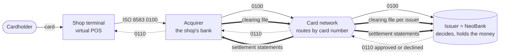
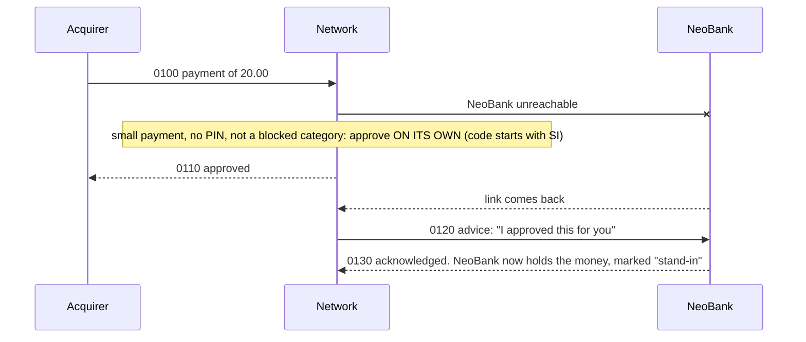
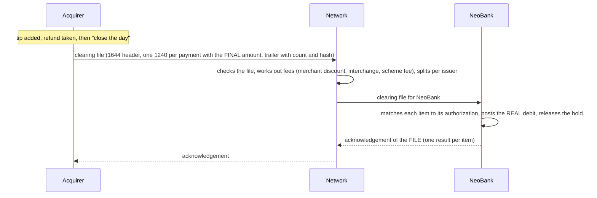
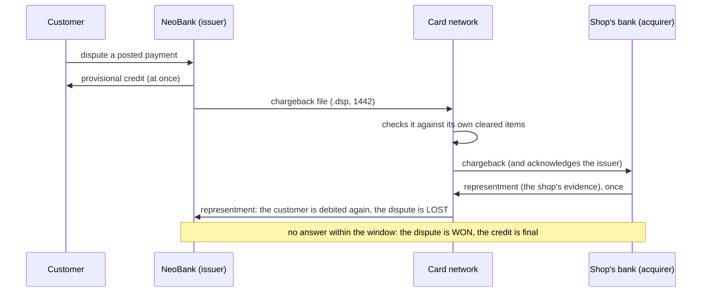
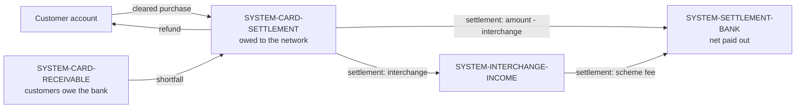

# NeoBank: a card payment, end to end, on your own machine

A learning project that follows **one card payment** through everything that happens in the real world, in the order it happens:
the shop's terminal asks, the card network routes, the bank (the *issuer*) decides in real time with an **ISO 8583** message and
reserves the money; at the end of the day the shop's bank sends a **clearing file** with the final amounts, the bank posts the real
debit; the network **settles** the day between the banks; and a **reconciliation** proves that what was authorized, what was cleared
and what was settled agree.

> **Honest scope.** NeoBank is a **card-issuing neobank simulation**, not a bank. No licence, no KYC or AML, no real card scheme:
> the messages are ISO 8583:1987 plus common usage, *not* a Visa or Mastercard profile (test card numbers start with 999900).
> Settlement is simulated: no real settlement bank, and the statements are readable, unsigned files. All keys are development
> defaults. One acquirer, one issuer. Do not point this at anything real. See [docs/LIMITS.md](docs/LIMITS.md).

## Run it (one command)

You need **Docker** and the four repositories cloned **side by side**:

```
somefolder/
  neobank-backend/    NeoBank: the issuer and the bank (Spring Boot, PostgreSQL, Flyway)
  neobank-frontend/   the bank's web app (Angular)
  neobank-cardnet/    the card network, the acquirer with its virtual POS, and the ISO 8583 codec (Java)
  neobank-demo/       this repository: compose file, scenario runner, docs
```

```bash
cd neobank-demo
docker compose up --build        # the first build downloads and compiles everything: a few minutes
java scenario/Scenario.java      # in a second terminal (JDK 21+): plays a whole card day and checks the outcome
docker compose down -v           # stops everything and deletes its data
```

**Faster, if you have a JDK and Node:** build the three artifacts yourself and let Docker only package them
(`docker-compose.prebuilt.yml`; handy while changing the code):

```bash
(cd ../neobank-cardnet && ./mvnw install -DskipTests) && (cd ../neobank-backend && ./mvnw package -DskipTests) && (cd ../neobank-frontend && npm ci && npx ng build)
docker compose -f docker-compose.yml -f docker-compose.prebuilt.yml up --build
```

| Address | What it is | Login |
|---|---|---|
| http://127.0.0.1:4200 | the bank (web app): Cards, History, Accounts | `demo@neobank.local` / `DemoPassw0rd` |
| http://127.0.0.1:4200 | the same app as the bank's admin: Clearing, Settlement | `admin@neobank.local` / `AdminPassw0rd` |
| http://127.0.0.1:9000 | the virtual POS (the shop's terminal): pay, tip, refund, close the day | none (test cards only) |
| http://127.0.0.1:8080 | NeoBank's API | |
| http://127.0.0.1:9100 | the card network's control API (status, chaos switches, settlement) | |

Everything is published to `127.0.0.1` only. The ISO 8583 ports are reachable between the containers and not published at all.
The demo customer's test card is `9999 0000 0000 0012`, PIN `4321` (a published test number, not a secret).
The scenario can be run once per ten minutes (a card may be approved ten times in ten minutes).

The **five-minute walk-through** is in [docs/DEMO-SCRIPT.md](docs/DEMO-SCRIPT.md). New to card payments? Start with the
[glossary](docs/GLOSSARY.md).

## The four parties



Three processes (plus the bank's web app and a database): **NeoBank** (`neobank-backend`) is the issuer. The **network** and the
**acquirer** (`neobank-cardnet`) are separate programs that talk to each other and to NeoBank over TCP with real ISO 8583 messages
and exchange files through a shared folder, the way banks use file transfers.

## What happens, in order

### 1. Authorization: the real-time part (milliseconds)

```mermaid
sequenceDiagram
    participant T as POS terminal
    participant A as Acquirer
    participant N as Network
    participant I as NeoBank (issuer)
    T->>A: card, PIN, amount
    A->>N: 0100 authorization request (ISO 8583)
    N->>I: 0100 (routed by the card number's first digits)
    Note over I: rules: card known, not frozen, PIN, limits, funds...
    I->>I: reserve the amount (a HOLD; the balance is not touched)
    I-->>N: 0110 response 00 + authorization code
    N-->>A: 0110
    A-->>T: approved
```

NeoBank's *available balance* is the ledger balance minus active holds. A declined payment is answered with a code (51 not
enough money, 55 wrong PIN, 57 not permitted, 61 over the limit...). Sending the same request twice gives the same answer and
holds the money once. If an answer is lost, the acquirer cancels with a **reversal** (0400) that is retried until acknowledged.

### 1b. When NeoBank is down: stand-in



### 2. Capture and clearing: the end of the shop's day



A tip clears for more than was authorized. If the customer no longer has the money, NeoBank still pays the network and keeps the
difference as a **receivable** that the next deposit or refund pays off (customer balances never go negative). A payment the bank
never authorized is posted anyway and flagged. The same payment presented twice is posted once.

### 3. Settlement: the money moves between the banks

For each cleared purchase: the issuer pays *amount - interchange + its scheme fee*, the acquirer receives *amount - interchange -
its scheme fee*, the network keeps both scheme fees: the three add up to zero. The network writes a CSV and a camt.053-style XML
statement per participant, with a value date (next business day). NeoBank **recomputes the figures itself** from the items it
posted before posting anything: a statement that does not agree is *disputed*, not trusted.

### 3b. Cash at a cash machine

A cash machine is a terminal with its own merchant category (6011) that sends the same authorization with **processing code 01**
and always the PIN. NeoBank refuses cash without a PIN, over 300 per withdrawal, or over 500 of cash per card per day (the cash also
counts toward the card's normal daily limit). The network's stand-in never approves cash. At the end of the day the withdrawal
clears and settles like a purchase.

### 3c. A pump that tops up (incremental authorizations)

A shop that does not know the final price (a fuel pump, a hotel) asks for a first authorization and may later ask for **more** on the
same payment: a new authorization whose DE 90 names the first one and whose amount is only the extra. NeoBank holds each addition
as an authorization of its own (so duplicates, expiry and reversal work as for any authorization) after checking the link: the first
one must still hold its money, be the same terminal and merchant, not be cash, have fewer than five additions, and the total must
stay within the per-transaction cap. At the end of the day the shop clears the **first** authorization for the final amount, and the
additions stop holding money.

### 3d. Online payments (card not present)

A payment in an online shop has no card in a terminal and **no PIN**. The shop's request has entry mode 812 (DE 22), condition code 59 (DE 25) and
the **security code** printed on the card in DE 53 (a simplification: real systems carry it in other private elements). NeoBank keeps only a keyed
hash of the code (like the PIN) and shows it **once**, when the card is issued. A wrong or missing code is answered **N7**, counts toward the same
three-strikes freeze as a wrong PIN and is checked before limits and funds; a PIN in an online payment is refused (57). The security code is never
stored or logged by any program (the shop's records, the queued reversals, the network's advices and the message dumps all leave it out), and the
card network's stand-in **never** approves an online payment, because only the bank can check the code.

#### The customer's approval (a simulation of 3-D Secure)

An online payment of **more than 30.00** needs one more thing: the customer's approval of exactly that payment. The bank declines the first
request with **1A** and puts a short reference in DE 48 of the answer (`3DS|K7M2QX`) and in a notification. The customer sees the request on the
Cards page (shop, amount, time left; it is open for 5 minutes) and approves or rejects it. The shop then sends a **new** request with DE 48
`3DS|K7M2QX` as the proof. The bank accepts it only if that approval is for the same card, amount and shop, is approved, not expired and not used;
it is **used up in the same transaction** as the authorization, so one approval pays once, even when two requests carry it at the same moment.
A rejected request is answered **05** for good; anything else is a new 1A. If the payment fails for lack of money, the approval is not used up.
This is only the idea of 3-D Secure: no directory server, no ACS, no cryptograms and no browser redirect. An online payment cannot be added to
(an addition carries neither the code nor an approval).

### 4. Disputes: chargebacks and representments

A customer disputes a posted payment. The bank **credits the amount at once** (provisional credit) and sends a **chargeback**
(MTI 1442) through the network in an encrypted `.dsp` file. The network checks it against its own cleared items (same card,
STAN and RRN, the issuer's own payment, at most the original amount, at most 120 days old, one chargeback per payment), forwards
it to the shop's bank, and settles it **like a refund**. The shop may answer **once** with a **representment** (a second
presentment with its evidence), settled **like a purchase**: the customer is debited again and loses. If nobody answers within
the window (30 seconds in this stack, two weeks by default) the customer wins and the credit is final. All of it is simulated:
no arbitration, no real scheme rules.



### 5. Reconciliation

An admin page compares, from NeoBank's records, what was **authorized**, **cleared** and **settled**, and lists every difference in
plain words: amount changed (a tip), cleared without approval, rejected, approved but never cleared, a disputed statement, a ledger
that disagrees. Cleared-but-not-yet-settled is shown separately and is not an exception.

## The ledger

Every movement of money is a **double-entry transaction with exactly two postings** that sum to zero, made by one piece of code.
Customer accounts can never go below zero; bank-internal (SYSTEM) accounts can.



## Try the failure cases

The POS page has switches (they live in the network process): **NeoBank is down**, **hold NeoBank's answers back**, **hold the
network's answers back**. Use them to watch stand-in approvals, late approvals that get reversed, and timeouts that become
reversals. The scenario runner does the first one for you.

## Look inside the files

```
neobank-cardnet/samples/     ISO 8583 messages (text, hex, decoded), a clearing file and its dump, an acknowledgement, settlement CSV and XML
```
Clearing files are encrypted (they carry card numbers); `ClearingDump` decrypts one with every card number masked. The samples
are decoded by a test on every build, so they cannot rot. ISO 8583 notes: `neobank-cardnet/docs/ISO8583-spec.md`.

## Tests

| Repository | How | What |
|---|---|---|
| neobank-cardnet | `./mvnw test` (Docker running: Testcontainers) | codec, network, acquirer, clearing, settlement, samples |
| neobank-backend | `./mvnw test` (Docker running) | issuer rules, holds, clearing, settlement, ledger, API |
| neobank-frontend | `npx ng test --watch=false` | every page |
| everything | `java scenario/Scenario.java` against the running stack | a whole day, end to end |

Beyond the unit tests, the important behaviours were **mutation-checked**: break the code on purpose and confirm that a test fails.

## Continuous integration

Each repository has a workflow in `.github/workflows/ci.yml` that runs on every push and pull request:

| Repository | What the workflow does |
|---|---|
| neobank-cardnet | `./mvnw clean verify`: every module and every test (the tests start a real PostgreSQL in Docker) |
| neobank-backend | checks out neobank-cardnet, installs its codec, then `./mvnw clean verify` |
| neobank-frontend | `npm ci`, the unit tests, the production build |
| neobank-demo | the scenario runner compiles and both compose files are valid; **and** (on the default branch, on demand and every night) the four repositories are checked out side by side, the stack is built with `docker compose up --build` and `scenario/Scenario.java` plays a whole card day against it |

The workflows assume the four repositories live under the same GitHub owner with these names and can be read by the workflow
(public, or give `actions/checkout` a token). The workflows have been run only as their individual commands, on a clean export of
the committed code on Windows with JDK 27 (the code is compiled for Java 21); they have not run on GitHub yet.

## More

- [docs/ARCHITECTURE.md](docs/ARCHITECTURE.md): the pieces, the ports, the files, the databases, and the main design decisions
- [docs/DEMO-SCRIPT.md](docs/DEMO-SCRIPT.md): the five-minute walk-through
- [docs/GLOSSARY.md](docs/GLOSSARY.md): issuer, acquirer, authorization, clearing, settlement, interchange, and the rest
- [docs/LIMITS.md](docs/LIMITS.md): what is simulated, what is simplified and what is not built
