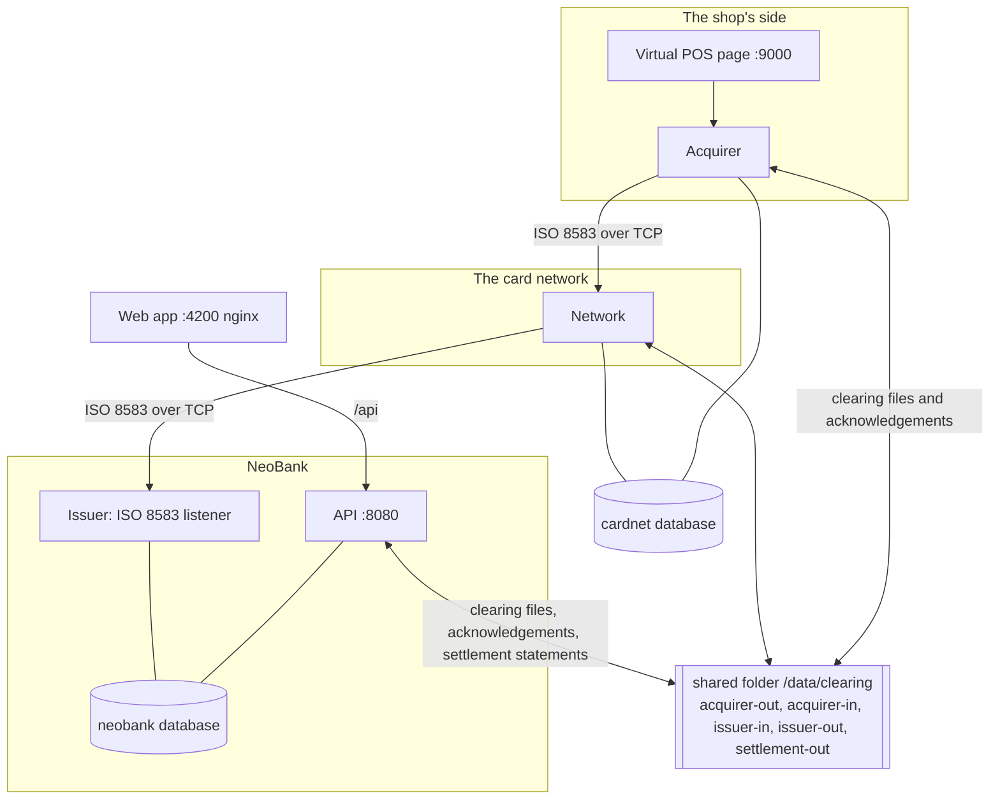

# Architecture

## The pieces

| Piece | Repository | Technology | Listens on (host) | What it does |
|---|---|---|---|---|
| NeoBank | `neobank-backend` | Spring Boot 4, JPA, Flyway, PostgreSQL | 8080 (API); ISO 8583 on 8583 *inside* the compose network | accounts, ledger, cards, the **issuer** (authorization, holds, reversals, advices), clearing ingest, settlement ingest, reconciliation, admin |
| Web app | `neobank-frontend` | Angular, Tailwind, served by nginx | 4200 | customer pages (accounts, transfers, history, cards) and admin pages (clearing, settlement, ...) |
| Card network | `neobank-cardnet/network` | plain Java 21, JDK `HttpServer`, virtual threads | 9100 (control API); the acquirer port 8601 inside the network | routes by BIN, link to the issuer, timeouts, stand-in, advices, clearing checks and fees, settlement |
| Acquirer and POS | `neobank-cardnet/acquirer` | plain Java 21 | 9000 | the shop's side: payments, durable reversals, voids, tips, refunds, batch close, the virtual POS web page |
| Codec | `neobank-cardnet/iso8583` | plain Java 21, no dependencies | | ISO 8583:1987 packager, TCP framing, inspector, PIN block, the clearing and acknowledgement file formats |
| Shared | `neobank-cardnet/shared` | plain Java + JDBC + Flyway | | PAN vault (AES-GCM), the reversal queue, sequences, the shared-folder helpers |
| PostgreSQL | | postgres:17 | not published | database `neobank` (NeoBank) and database `cardnet` (the network and the acquirer) |

## How they talk

- **Real time** is TCP with two-byte length framing and ISO 8583 ASCII messages. The issuer keeps one connection per network, with sign-on and echo tests; the acquirer opens a short connection per exchange.
- **Batch** is a shared folder, a stand-in for the SFTP servers of real schemes. Each folder has one writer and one reader; files are written under a temporary name and renamed, so a reader only sees finished files. Clearing files and acknowledgements are AES-256-GCM encrypted with the *file name* as associated data (a renamed or replaced file is refused); settlement statements carry totals only and are readable.
- **Databases never cross:** NeoBank and the network programs share *no* tables; everything between them is a message or a file.

## Design decisions worth knowing

1. **One piece of code moves money.** `LedgerService.post` writes exactly two postings that sum to zero, locks the accounts in id order, and refuses a debit that would cut into holds. Everything else (deposits, transfers, interest, card clearing, settlement) goes through it.
2. **Holds before debits.** An authorization inserts a hold under the account's row lock; the available balance is the balance minus active holds, read at query time (expiry is time-based, not a job). Clearing flips the authorization to captured and posts the real debit under the same lock order (account first, then card).
3. **Idempotency everywhere.** Duplicate authorizations are replayed by a unique key; a clearing item is inserted first under a unique (file, record) key and an ingest that finds it returns the stored result; a settlement statement is inserted first under a unique file name. Concurrent attempts are handled by the database, not by hoping.
4. **No customer balance goes negative, but the bank still pays.** A cleared amount the account cannot cover becomes a receivable (a SYSTEM account and a table); deposits and refunds pay it off, and new card payments are declined meanwhile.
5. **Do not guess about answers that did not come.** A timeout becomes a reversal that is stored durably and retried (1, 2, 4, 8, 16 s, then every minute, for 24 hours); a late approval after the network answered on its own is reversed.
6. **Trust but verify across party lines.** The network checks every file and item; NeoBank recomputes the settlement figures from its own items and disputes a statement that differs.
7. **Crash safety by construction.** Each multi-step operation commits its state first and does the external side effect (writing a file) after, from stored data, so a restart repairs it: batches, issuer files, acknowledgements and settlement files all have this shape.
8. **Secrets stay out.** (The security code of an online payment is one more: only a keyed hash is kept at the bank, and every copy of a message that is stored, queued or advised leaves DE 53 out.) Card numbers are never stored in the clear: a keyed hash plus the last four digits at the bank, AES-GCM ciphertext where a message must be rebuilt; PIN data is never stored, not even encrypted; logs, hex dumps and every admin page mask the number. Tests scan tables, files and logs for card numbers.

9. **A proof is used once, in the same transaction as the payment it pays for.** The customer's approval of an online payment above 30.00 is a row (`card_authentications`); the shop's retry names it in DE 48. The check in the engine and the atomic UPDATE that marks it used are two guards of the same rule, so one approval pays once even for two simultaneous requests, and a payment that fails for lack of money does not burn it.
10. **Think through every path that reaches a rule.** An addition to an online payment would have skipped the security code and the approval, so it is refused at the acquirer and at the bank.

## Configuration (environment)

| Variable | Used by | Default | Meaning |
|---|---|---|---|
| `SPRING_DATASOURCE_URL`, `SPRING_PROFILES_ACTIVE` | NeoBank | local Postgres, none | database; `demo` seeds a demo customer, a card and six months of activity |
| `CARD_LISTENER_HOST` | NeoBank | `127.0.0.1` | where the ISO 8583 listener binds (a container needs `0.0.0.0`) |
| `CARD_PAN_KEY`, `JWT_SECRET` | NeoBank | development defaults | key of the card-number and PIN hashes; JWT signing |
| `CARDNET_DB_URL` | network, acquirer | local `cardnet` database | their database |
| `CARDNET_BIND` | network, acquirer | `127.0.0.1` | where their ports bind (a container needs `0.0.0.0`) |
| `CARDNET_ROUTES` | network | `999900=127.0.0.1:8583` | card-number prefix to issuer address |
| `CARDNET_NETWORK_HOST`, `CARDNET_NETWORK_CONTROL_URL` | acquirer | loopback | where the network is |
| `CARDNET_DATA_DIR` | all three | `./data/clearing` | the shared folder |
| `CARDNET_FILE_KEY`, `CARDNET_VAULT_KEY` | all three | development defaults | file encryption key text, PAN vault key (must be the same everywhere) |
| `CARDNET_HOLIDAYS` | network | none | non-business days besides weekends, `2026-12-25,...` |

## Where to read the code

- **Issuer rules** (the order matters): `neobank-backend/.../card/auth/AuthorizationEngine.java`
- **Clearing at the issuer**: `.../card/clearing/ClearingPoster.java`; **settlement**: `SettlementPoster.java`; **reconciliation**: `SettlementReconciliation.java`
- **The network**: `neobank-cardnet/network/.../PaymentRouter.java` (routing, stand-in), `ClearingProcessor.java`, `SettlementService.java`
- **The acquirer**: `neobank-cardnet/acquirer/.../AcquirerService.java`, `AcquirerClearing.java`
- **The codec**: `neobank-cardnet/iso8583/.../Packager.java`, `clearing/ClearingFileCodec.java`
